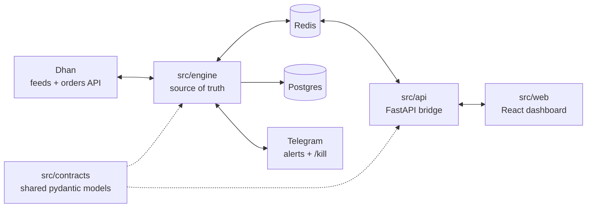

# CLAUDE.md — SentinelX

Guidance for Claude Code working in this repository. Read this first, then [`PRD.md`](PRD.md). Architectural rationale lives in [`docs/DECISIONS.md`](docs/DECISIONS.md). OpenSpec's workflow lives in `.claude/skills/` and `.claude/commands/opsx/` plus `openspec/config.yaml` (generated by `openspec init` — don't hand-edit the skills). `CLAUDE.md` is the single source of agent instructions; if another tool (e.g. Antigravity) is added later, create a thin `AGENTS.md` that points here rather than duplicating rules.

## What this is

SentinelX is a self-hosted trading platform for Dhan. A **headless Python engine** owns all trading state and is the only thing that talks to the broker. A **FastAPI** bridge and a **React** dashboard are optional clients. Real money is at stake: correctness and safety beat speed of delivery.

## Architecture at a glance



### Import boundaries (enforced by `import-linter` in CI)
- `api` **must not** import `engine`.
- `contracts` **must not** import any other internal package (including `observability`).
- `observability` **must not** import `engine`, `api` or `cli`.
- Only `engine.broker` may import `dhanhq` or make HTTP calls to Dhan.

If a task seems to need breaking one of these, stop and propose an OpenSpec change instead.

## Phase 1 scope: single account

- Stages 0–7 run **one Dhan account** (the owner's). Every contract, DB table, log line, and risk record still carries `account_id` (D-020).
- Do **not** build multi-account routing, per-account loops, or an account switcher before Stage 8.
- Keep market data (`MarketDataProvider`) separate from execution (`BrokerAdapter`), even though both are Dhan today (D-023).
- No Zerodha code (D-022).

## Repository layout

```
src/
  contracts/   shared pydantic models: commands, events, snapshots
  observability/ shared runtime telemetry: logging, masking, tracing (D-024)
  engine/      main.py (asyncio entry), market_data/, broker/, orders/,
               positions/, risk/, exits/, bus/, persistence/, telemetry/
  api/         FastAPI app: REST commands + WebSocket stream, auth
  cli/         developer CLI for Stages 2–5
  web/         React + TS + Vite + Tailwind + shadcn/ui + Zustand
tests/         contracts/, engine/, api/, integration/
openspec/      project.md, specs/<domain>/, changes/<change-id>/
docs/          DECISIONS.md, architecture.md, runbook.md
docker/        engine / api / web Dockerfiles
infra/         caddy/, otel/, postgres/
scripts/       gen-types.sh, db reset, seed instruments
```

## Workflow: OpenSpec, stage by stage

1. **No implementation without an approved change.** Work maps to a stage in `PRD.md` §11. Create the change with the OpenSpec slash command (e.g. `/opsx:propose <change-id>`), producing `proposal.md`, `tasks.md`, optional `design.md`, and spec deltas.
2. Spec deltas use `## ADDED|MODIFIED|REMOVED Requirements`; every requirement uses SHALL/MUST and has at least one `#### Scenario:`.
3. Run `openspec validate <change-id> --strict` and wait for the owner's approval before coding.
4. Implement tasks in order; tick boxes in `tasks.md` as each completes.
5. If implementation reveals that a decision in `docs/DECISIONS.md` should change, **stop and say so** — add a new decision entry marked as superseding the old one; never silently diverge.
6. When merged, archive the change (`openspec archive <change-id> --yes`).

One stage may span several changes; keep each change reviewable (roughly one domain at a time).

## Commands

```bash
uv sync                          # install Python deps into .venv
uv run ruff format .             # format
uv run ruff check .              # lint
uv run mypy src                  # type check (strict)
uv run lint-imports              # enforce import boundaries
uv run pytest                    # all Python tests
uv run pytest tests/engine -k risk   # subset

docker compose up -d             # full stack, paper mode
docker compose logs -f engine
uv run python -m engine.main     # engine alone (needs redis + postgres)
uv run python -m cli --help      # dev CLI

cd src/web && npm run dev        # dashboard dev server
./scripts/gen-types.sh           # regenerate TS types from FastAPI OpenAPI
openspec list                    # active changes
openspec validate <change-id> --strict
```

Definition of done for any task: format, lint, mypy, import-linter, and tests all pass; `openspec validate --strict` passes.

## Safety rules (non-negotiable)

1. **Paper is the default.** Live trading requires `TRADING_MODE=live` **and** `LIVE_CONFIRM=yes`. Never change defaults, test fixtures, or compose files to enable live mode.
2. **Every order goes through the risk engine** — manual, strategy, webhook, or exit. No bypass flags, not even for tests; test the risk engine itself instead.
3. **Never weaken a risk check to make a test pass.** Fix the code or ask.
4. **Never blindly retry order placement.** On timeout the order becomes `Unknown` and is reconciled against Dhan's order book first.
5. **Idempotency keys on every order command.** Duplicate keys return the original result.
6. **No per-tick order modification at Dhan.** Trailing levels live in the engine; the broker sees one entry, one catastrophic SL, one exit.
7. **Exit before cancel** when replacing the catastrophic SL with an exit.
8. **Kill switch must not depend on the API, Redis consumer, or dashboard.** The Telegram `/kill` path is handled inside the engine.
9. **Fail closed.** If risk state, config, or persistence is unavailable, reject new entries; keep managing existing exits.
10. **No secrets in code, logs, tests, or traces.** Mask tokens and account IDs in logs. Never log broker request or response bodies; log selected fields only.
11. **No tests call the real Dhan API.** Use `PaperBroker`, `SimulatedFeed`, and recorded fixtures.
12. Respect Dhan limits (PRD §10) via the central rate limiter; exits get priority.

## Code conventions

### Python
- Python 3.12, managed by `uv`. Code under `src/`, tests mirrored under `tests/`.
- `mypy --strict` clean. Type every function; prefer `Protocol` (structural interface, like a C# interface) for adapters such as `BrokerAdapter`.
- **Engine is async.** One `asyncio` event loop. Never call blocking I/O (`requests`, `time.sleep`, sync DB drivers) inside it — use `httpx.AsyncClient`, `asyncio.sleep`, `redis.asyncio`, async SQLAlchemy. If an SDK call is blocking, wrap it with `asyncio.to_thread`.
- **Money and prices are `Decimal`**, never `float`. Round prices to the instrument's tick size.
- **Datetimes are timezone-aware.** Store UTC; convert to `Asia/Kolkata` for market-hour logic and display.
- All cross-process messages are pydantic v2 models in `contracts`, versioned with a `schema_version` field.
- Logging via `structlog` (JSON); include `trace_id`, `account_id`, `order_id` where relevant. Wrap order paths in OpenTelemetry spans and record broker round-trip latency.
- Persistence: SQLAlchemy 2.0 async + Alembic migrations. Never edit a migration that has run; add a new one.

### TypeScript / web
- Strict TypeScript. Never hand-write API types — regenerate with `scripts/gen-types.sh`.
- Live data through one WebSocket client feeding Zustand stores; components subscribe with selectors so only changed rows re-render.
- The UI never computes P&L or risk; it displays engine values.
- Trade button: disabled while pending, fresh idempotency key per click. Kill switch: hold-to-confirm, always visible.

## Testing expectations

- Unit test every risk rule and every order state transition.
- Property-based tests (`hypothesis`) for trailing-SL math and position sizing.
- Integration tests run engine + Redis + Postgres (docker) with `SimulatedFeed` + `PaperBroker`, including kill -9 / restart recovery.
- Async tests use `pytest-asyncio`.

## How to explain your work to the owner

The owner is an experienced C#/.NET developer, newer to Python and to trading automation.
- Skip general programming concepts.
- In code comments and summaries, **explain Python-specific idioms** (decorators, context managers, `async` patterns, `Protocol`, pydantic, dataclasses) when they first appear in a change, with a C# analogy where helpful.
- **Explain trading logic and terms** (MTM, tick size, lot size, freeze qty, SL-M, trailing logic) in comments where the code implements them.
- Call out configurable parameters and where to change them.
