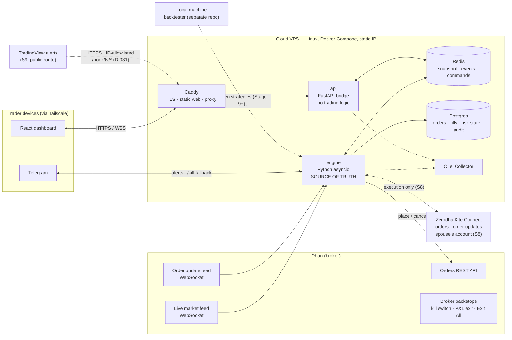
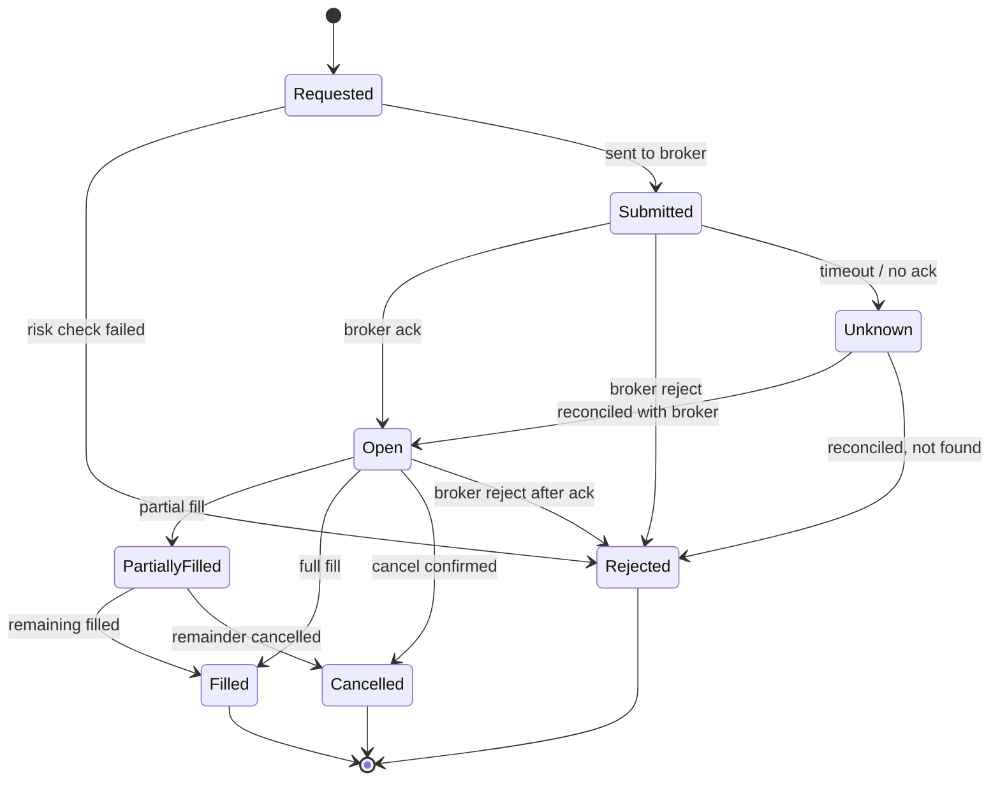
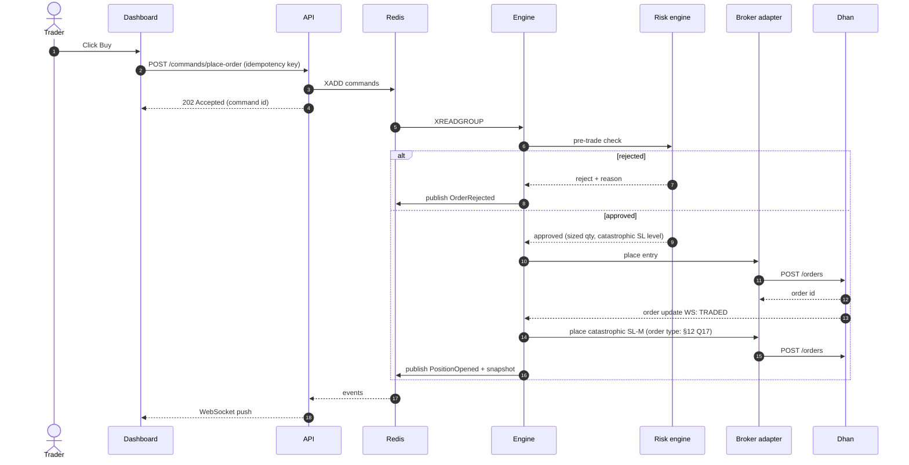
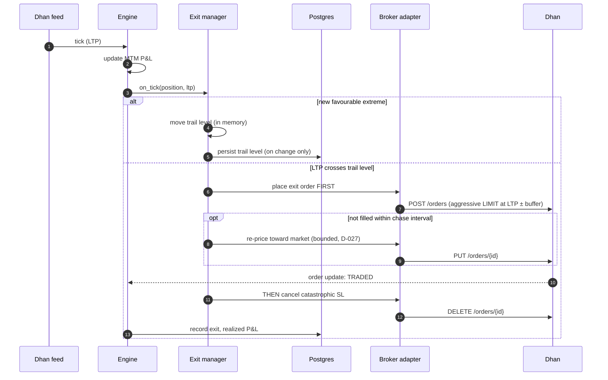
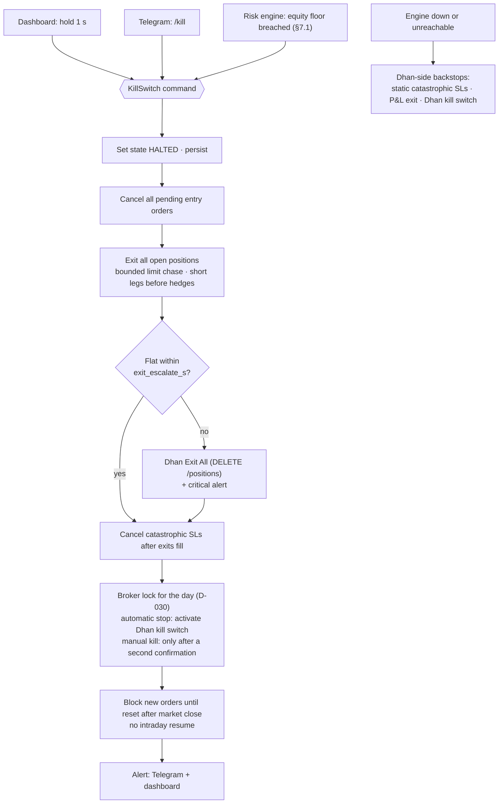
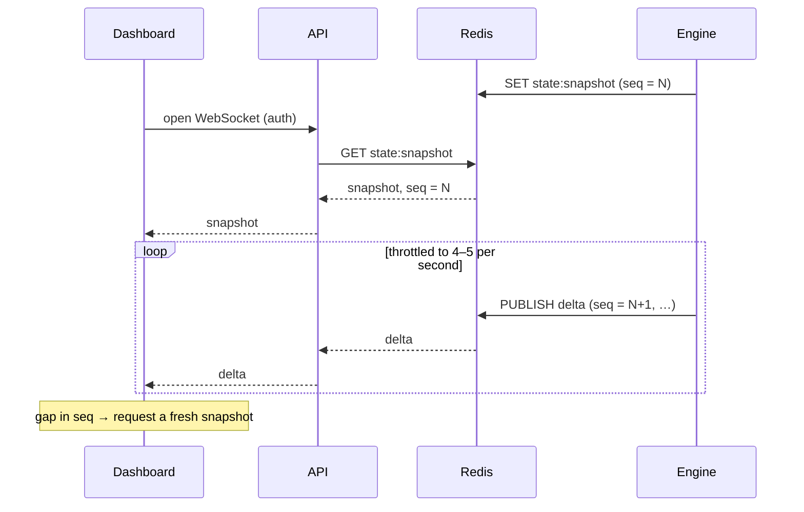
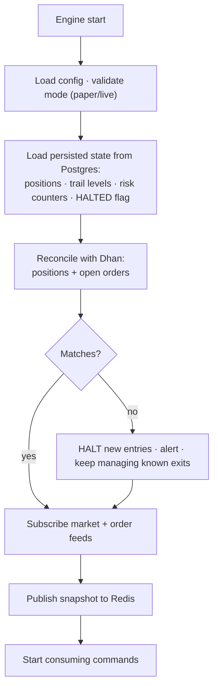
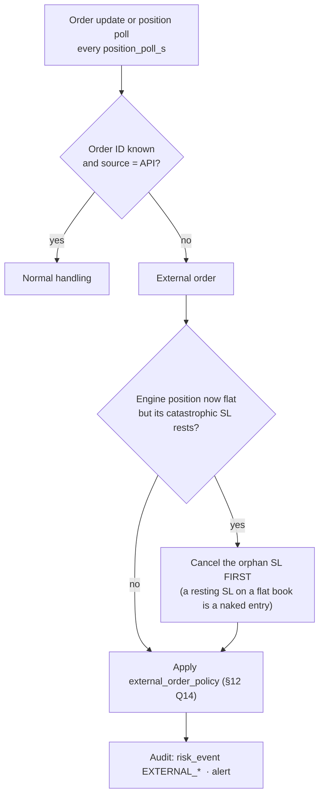
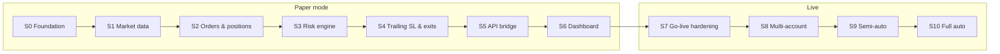

# PRD — SentinelX

| | |
|---|---|
| **Owner** | Balaji |
| **Status** | Draft v3 |
| **Last updated** | 2026-11-11 |
| **Brokers** | Phase 1 (S0–S7): Dhan (DhanHQ API v2), owner's account · Phase 2 (S8): + Zerodha (Kite Connect), spouse's account (D-029) |
| **Use** | Personal and family only, not commercial |
| **Markets** | NSE F&O intraday (primary), NSE equity |
| **Related** | [`CLAUDE.md`](CLAUDE.md) · [`docs/DECISIONS.md`](docs/DECISIONS.md) · [`README.md`](README.md) · [`docs/research/`](docs/research/) |

> Placeholder decisions pending confirmation are marked **⚠ ASSUMPTION** (see §12).
>
> **v3 (2026-11-11):** adds ideas from three external teardowns of MyAlgoMate products. [TradeBridge](docs/research/tradebridge.md) covers webhook signals, [TradeMate](docs/research/trademate.md) covers manual options execution, and the [RMS Tool](docs/research/rms-tool.md) covers risk rules and Dhan backstops. Items taken from them cite the source in brackets, for example **[RMS R2]**. They are **hypotheses**: every number taken from them is an example to backtest or verify, never a default. Dhan behaviours they describe are marked *verify* until confirmed against Dhan's docs or a recorded response.

---

## 1. Summary

A self-hosted, always-on trading platform for personal and family use, running on a Linux VPS. A headless Python engine owns all trading state (positions, P&L, stop-losses, risk limits) and is the **only** component that talks to the brokers: Dhan in phase 1, plus Zerodha for the spouse's account in phase 2. A React dashboard lets a human trade with one click, watch live positions, and hit an emergency kill switch. The platform starts with manual entries and automated exits, and grows stage by stage toward fully automated strategies.

## 2. Goals and non-goals

### Goals
1. **Safe execution** — every order, manual or automated, passes the same risk engine.
2. **Automated position management** — trailing stop-loss, exits, and daily loss limits run in the engine, with or without a browser open.
3. **Fast, clear dashboard** — live position values within about 1 second, one-click trade, hold-to-confirm kill switch, usable on a phone.
4. **Observability** — every order traceable end to end (OpenTelemetry), with measured latency.
5. **Incremental path to full automation** — manual → semi-auto → full auto by switching modes, not rewriting.

### Non-goals (this repo)
- Strategy backtesting (stays on the local machine, separate project — D-005).
- Charting / trading from charts.
- Commercial use: no SaaS, no selling, no running accounts for anyone outside the family. SentinelX is a personal tool for the owner and spouse, within SEBI's family-use allowance for self-built algos.
- Rust engine (deferred; swap point is the `BrokerAdapter` — D-009).
- F&O Trade Validator (stays a separate service; may plug in as an extra pre-trade check in Stage 9).
- Any broker other than Dhan (phase 1) and Zerodha (phase 2, the spouse's account only — D-029); no Zerodha code before Stage 8.
- Payoff graphs, Greeks panels and MTM-history charts of the kind TradeMate has: the dashboard has no charts (D-014).
- Copy trading, multi-user licensing, and support for many brokers.

## 3. Operating modes

| Mode | Who decides entries | Who manages exits | Available from |
|---|---|---|---|
| **Manual** | Trader clicks Trade | Engine (trailing SL, risk) | Stage 6 |
| **Semi-auto** | Strategy proposes, trader approves | Engine | Stage 9 |
| **Full auto** | Strategy | Engine | Stage 10 |

Independently, every mode runs in **Paper** (simulated fills against live prices, no broker orders) or **Live**. Paper is the default; Live requires explicit configuration (§9.3).

## 4. Architecture



### 4.1 Components

| Component | Responsibility | If it fails |
|---|---|---|
| **engine** | Market data, orders, positions, MTM P&L, risk engine, trailing SL, Telegram alerts/kill fallback. Only code that calls a broker. | Exchange-side catastrophic SLs + Dhan backstops protect positions; engine auto-restarts and reconciles (§6.5). |
| **Redis** | Latest state snapshot, event deltas (pub/sub), command queue (Redis Stream). | Engine keeps trading and persisting; dashboard goes stale. |
| **Postgres** | Durable record: orders, fills, positions, trail levels, daily risk counters, audit log. | Engine halts new entries (fail closed), keeps managing exits in memory, alerts. |
| **api** | Translates Redis ↔ browser (REST commands, WebSocket stream), auth. | No effect on trading. |
| **web** | Display + human commands. | No effect on trading. |
| **Caddy** | HTTPS, serves built web files, proxies `/api` and `/ws`. | Dashboard unreachable; Telegram fallback still works. |

### 4.2 Hard boundaries (enforced in CI by `import-linter`)
- `api` never imports `engine`.
- `contracts` imports nothing internal and holds only messages and shared types.
- `observability` (shared logging, masking, tracing) never imports `engine`, `api` or `cli`; `contracts` never imports it (D-024).
- Only `engine.broker` imports the `dhanhq` SDK (and, from S8, `kiteconnect`) or calls a broker.
- Market data (`MarketDataProvider`) is a separate interface from execution (`BrokerAdapter`), even though both are Dhan today (D-023). In S8 the Dhan feed keeps serving both accounts, and Zerodha is used for execution only (D-029).
- **Broker-specific backstops are optional capabilities** of a broker adapter, not core steps: P&L exit, account kill switch, Exit All. The engine checks whether an adapter has one before using it. When it doesn't, the engine's own lock still applies and the owner is alerted to use the broker's manual control (D-029, D-030).

## 5. Order lifecycle



**Rule:** an order in `Unknown` is **never** blindly retried — the engine reconciles against Dhan's order book first. Retrying could double the position.

## 6. Key flows

### 6.1 Manual order placement



In **Paper** mode, the broker adapter is `PaperBroker`: it fills against the live LTP (last traded price) with configurable slippage, deducts trading costs (brokerage, STT, exchange/SEBI fees, stamp duty, GST), and never calls Dhan.

### 6.2 Tick → trailing stop-loss → exit



- The trailing level lives **only in the engine** — no per-tick order modification at Dhan (D-006).
- **How** the level moves is a selectable method (ATR Chandelier, N-candle low, Supertrend, step trail, Parabolic SAR, EMA close, fixed %, …), chosen per trade with a configured default (D-025). Catalogue and decision guide: [`docs/trailing-sl.md`](docs/trailing-sl.md). Every method only ever tightens the stop.
- **Exit before cancel:** placing the exit first keeps the position protected during the ~150–300 ms of two broker calls (D-007).
- **Exits are limit orders, never MARKET (D-027) [RMS R10].** Dhan turns API market orders into limit orders with Market Price Protection (MPP), a cap near LTP, and these can sit unfilled on a fast or illiquid strike (*verify*). An exit is therefore placed as an aggressive LIMIT at LTP ± `exit_buffer_pct`. It is re-priced every `chase_interval_ms`, at most `max_chase_steps` times (always fewer than the per-order modification cap, §10), and never beyond `max_exit_slippage_pct`. A bounded number of re-prices is not per-tick modification, so D-006 still holds.
- **Timed exits catch up [TradeMate F11].** A timed exit whose time passed while the engine was down fires at startup, after reconciliation, if the position is still open.
- **Partial exits [TradeMate 3.4].** An exit can be 25/50/75/100% of the position or a custom quantity, rounded down to whole lots. The catastrophic SL quantity is reduced to match the remaining position, and the trail state is kept.

### 6.3 Kill switch



The Telegram path is handled **inside the engine**, so it works when the API, Redis consumer, or dashboard is down.

- **Short legs before hedges [RMS R10].** When short options are flattened, the short leg is exited before its protective long. Dhan may block the hedge exit, or need extra margin, while the short is still open (*verify*). This matters only once multi-leg trading is in scope (§12 Q10).
- **Exit All is a last resort.** It also cancels every open order, catastrophic SLs included, so the engine reconciles straight afterwards.
- **The day is locked: an emotional circuit breaker (D-030).** An automatic stop (equity-floor breach or daily profit target) halts the account until the post-close reset.
  - **No intraday resume.** There is no resume command for a risk halt. The `recovery resume` command clears only a *reconciliation* halt (§6.5) and never a risk halt.
  - **Broker lock.** Once the book is flat, the engine also activates Dhan's kill switch, so the Dhan app and web are locked too. Dhan accepts it only on a flat book with no pending orders. After a second activation in a day it can't be undone manually (*verify*); that is accepted as the point of the rule.
  - **Manual kills.** A manual kill from the dashboard or Telegram activates the broker lock only after a second confirmation.
  - **Brokers without a lock API.** A broker with no lock API (Zerodha in S8, *verify*) gets the engine lock plus an alert asking the owner to lock the account manually.
  - **Limits stay tighten-only** during the day (§7.2).

### 6.4 Dashboard connect (snapshot + deltas)



### 6.5 Engine startup and recovery



- **Ratchets never go backwards on restart.** For risk state that only ever moves one way (the equity floor and the day's peak MTM, §7.1), the engine resumes with `max(persisted, recomputed)`. TradeMate deliberately clears its rules on restart [TradeMate §7]; SentinelX persists them and re-validates them against the broker.
- **Missed timed exits** are fired after reconciliation (§6.2).

### 6.6 External (manual) orders — continuous detection

Startup reconciliation (§6.5) only catches drift once. Dhan's order-update WebSocket reports every order on the account "irrespective of the platform", with a `Source` field (`P` for API orders), so the engine can detect external orders continuously (D-028) [RMS R7] (*verify the field against recorded responses*).



- **Drift** means the broker's net quantity differs from what the engine expects for longer than `drift_grace_s`. Drift raises the account to at least HALT_NEW_ENTRIES.
- After an order-update WebSocket reconnect, the engine backfills from the order book before trusting the feed again.
- An adopted external position counts against every risk limit and gets a catastrophic SL.

## 7. Risk engine requirements

All limits are configuration, stored in Postgres, editable from the dashboard. Values below are **examples, not recommendations**. The last column shows which S3 change builds the rule: **A** = `add-risk-engine`, **B** = `add-risk-guards`, **—** = moved out of S3 (the row says where).

`MTM_day` = the day's realized P&L + the unrealized P&L of open positions at current prices, net of estimated charges (D-032). A position carried over from an earlier day is measured from its previous close, so only today's move counts.

| Rule | Definition | Example | On breach | S3 |
|---|---|---|---|---|
| Per-trade max risk | (entry − SL) × qty × lot size | ₹1,000 | Reject order | A |
| Position sizing | Qty derived from per-trade risk, rounded **down** to whole lots | — | Auto-size; reject if < 1 lot | A |
| **Equity floor** (replaces "daily max loss") | `MTM_day ≤ floor`. The floor starts at −`daily_max_loss` and only ever rises (§7.1) [RMS R2] | starts at −₹3,000 | Kill switch (§6.3) | A |
| Max trades per day | Count of entries | 10 | Reject new entries | A |
| Consecutive-loss cooldown | N losses in a row → pause | 3 → 30 min | Reject entries until cooldown ends | A |
| Max open positions | Concurrent positions, total and per underlying | 5 / 2 | Reject order | A |
| Entry cutoff | No new entries after time | 15:00 IST | Reject entries | A |
| Own square-off | Exit all intraday positions before Dhan's auto square-off (15:18–15:20, *verify* — §10) | 15:10 IST | Auto-exit | A |
| Price sanity | Limit price within ±X% of LTP | 2% | Reject order | A |
| Quantity sanity | Per-order qty ≤ exchange freeze quantity | per underlying | Reject or slice | A |
| Broker rate limit | Client-side token bucket (§10), with a share of tokens reserved for exits and cancels | Dhan limits | Queue by priority (exits first) | A |
| Stale data / outliers [RMS R9] | No tick for `stale_s` → reject entries priced from that quote. No ticks at all for `feed_down_s` → HALT_NEW_ENTRIES and compute MTM from REST quotes. MTM unknown for `mtm_blind_s` → flatten. A tick that jumps more than `outlier_pct` and isn't confirmed never updates the day's peak | 5 s / 10 s | As stated | A |
| Limit edits in market hours | **Tighten-only** during 09:15–15:30 IST, judged by each parameter's declared direction (§7.2) | — | Loosening rejected until close | A |
| Daily profit target [RMS R1] | `MTM_day ≥ daily_profit_target` for `target_confirm_ticks` consecutive MTM updates | ₹4,000 · 2 | HALTED_TARGET: flatten, block entries for the day, broker lock (D-030), stay halted even if MTM falls back | B |
| Lot caps [RMS R3] | open lots + lots of pending entries (reserved until terminal) + this order ≤ the cap per underlying and in total; gross entry lots today ≤ the daily cap | 4 / 8 / 20 lots | Reject entry | B |
| Entry pacing [RMS R6] | Max entries per minute; minimum seconds between entries | 3 / 20 s | Reject entry | B |
| Rejection breaker [RMS R6] | `reject_breaker_n` broker rejections within a rolling 5 minutes | 3 | HALT_NEW_ENTRIES + alert | B |
| Modification cap [RMS R6] | Re-prices per order stay below Dhan's per-order cap (§10) | 20 | Stop re-pricing; escalate (§6.3) | — (moved to S4 `add-trailing-exits`, 2026-11-21) |
| Expiry-day profile [RMS R8] | Overrides for contracts expiring today (expiry date taken from the instrument master, never inferred from the weekday): earlier entry cutoff and square-off, tighter lot caps and giveback. Each override must be at least as tight as its base value | cutoff 14:00 | As the overridden rule | B |
| Instrument policy [RMS R4] | Allow/deny lists, F&O ban list (loaded before the open; fail closed if missing), max strike distance from ATM, minimum premium, maximum bid-ask spread % (*deferred* 2026-11-21 until a market-depth feed exists: the Quote-mode feed carries no bid/ask) | spread 3% | Reject entry | B (spread check deferred) |

**Exits are never blocked by entry limits.** Caps, pacing, cutoffs and instrument policy apply to entries only. Exits still pass through the `RiskGate` (CLAUDE.md safety rule 2) and the rate limiter, where they have priority.

**Fail closed:** if risk state can't be loaded or checked, the order is rejected. If a continuous check can't run, the account goes to at least HALT_NEW_ENTRIES.

### 7.1 Equity floor ratchet (D-026) [RMS R2]

One `floor` (in ₹ of `MTM_day`, per account per day) takes the place of five separate vendor settings: Max Loss, Trail Max Loss, Lock Minimum Profit, Trail Profits and Lock & Trail. It also adds a giveback limit (maximum drawdown from the day's peak). The floor only ever rises:

```
peak         = max(peak, MTM_day)                    # fresh, non-outlier data only
f_static     = -daily_max_loss
f_trail_loss = -daily_max_loss + floor(peak / trail_loss_x) * trail_loss_y         # when peak > 0
f_lock       = lock_at                                 # LOCK, LOCK_AND_TRAIL; when peak >= lock_trigger
f_trail      = floor(peak / trail_step) * trail_by                                  # TRAIL
             = lock_at + floor((peak - lock_trigger) / trail_step) * trail_by       # LOCK_AND_TRAIL
f_giveback   = peak - max(giveback_abs, giveback_pct * peak)   # when peak >= giveback_arm
floor        = max(floor_prev, f_static, f_trail_loss, f_lock, f_trail, f_giveback)
```

- Each term is optional (off unless configured). `lock_mode` is one of OFF / LOCK / TRAIL / LOCK_AND_TRAIL.
- **The trail term starts at its first whole step.** In TRAIL mode `f_trail` adds nothing until `peak ≥ trail_step`; read literally, `floor(peak / trail_step) = 0` would lift the floor to ₹0 before the day had made any money and kill on the first tick.
- **Validation.** `trail_loss_y` may equal but not exceed `trail_loss_x`; `trail_by` must be below `trail_step`; `giveback_pct` is a percent number strictly between 0 and 100 (30 means 30%).
- **A pre-trade check also uses the floor:** an entry is rejected if `MTM_day − its per-trade risk ≤ floor`.
- **The floor is a trigger, not a price guarantee.** A gap through it fills worse than the floor.
- **No debounce on the loss side.** Debounce (N consecutive ticks) is allowed only for the profit target. The vendor's delayed or tick-confirmed exit modes are not copied for losses.
- **Property tests come from these formulas,** not from vendor examples: one of the vendor's published examples is internally inconsistent [RMS A.3].

### 7.2 Rule interface, state and tightening (D-026)

- **One interface.** Each rule is a `RiskCheck` (a `Protocol`) with a pre-trade phase, a continuous phase (on a tick, MTM update, order update or timer), or both.
  - It returns a decision ranked by severity: ALLOW < REJECT < HALT_NEW_ENTRIES < TARGET_HALT < KILL.
  - The gate acts on the most severe decision.
  - A check that raises an exception counts as REJECT (pre-trade) or HALT_NEW_ENTRIES (continuous).
- **Persist before acting.** Changes to state that only moves one way (floor, peak) are written before the action, using SQL `GREATEST(existing, new)`. A stale or out-of-order write can then never lower them. The kill is idempotent per `(account_id, trade_date)`.
- **Engine-owned state.** The floor, peak, halt state and day counters are never editable from the UI or the API.
- **Declared tightening direction.** Every parameter declares its unit (INR, INR_PER_LOT, PCT, LOTS, SECONDS, COUNT, TIME_OF_DAY, ENUM, BOOL) and its tightening direction (`up`, `down`, `enable_only`, `enum_order`). `TIME_OF_DAY` is an `HH:MM` clock time in IST, such as the entry cutoff and the square-off time; an earlier time is tighter (`down`).
  - During market hours a config change is accepted only if every changed parameter moves in its tightening direction.
  - It must also not lower the floor when the floor is re-simulated with the new values. Otherwise it is rejected with `TIGHTEN_ONLY`.
- **Shadow mode.** A new rule can run in `shadow` mode, logging its decisions without enforcing them, before it is switched to `enforce`.

### 7.3 Risk audit

- Every risk decision goes to an append-only `risk_event` table: time, `account_id`, rule, phase, decision, a stable reason code (e.g. `RISK_LOTS_UNDERLYING`), the inputs, and the check's latency.
- Skipped or rejected signals are logged the same way, so "why didn't it trade?" always has an answer [TradeBridge §2, execution log].

## 8. Dashboard requirements

- **Positions table:** instrument, qty, avg price, LTP, MTM P&L, trail level, distance to trail — updated live (≤ 1 s staleness).
- **Trade panel:** instrument search, Buy/Sell, SL distance, trailing method (pre-filled with the configured default, changeable per trade, with its parameters), computed qty and ₹ risk shown before submit; button disabled while pending; unique idempotency key per click.
- **Order feedback:** Pending → Placed → Filled / Rejected (with Dhan's reason).
- **Kill switch:** hold-to-confirm (~1 s), always visible.
- **Risk status:** today's P&L vs the equity floor and profit target, trades used, cooldown timer, HALTED banner.
- **Equity number line [RMS A.6]:** floor · peak · current MTM · profit target on one horizontal line, all engine values. It is a single bar, not a chart.
- **Active Rules panel [TradeMate 3.5]:** one list of everything armed for the account. That covers each position's catastrophic SL and trailing method, timed exits, floor and lock settings, and the profit target. Each item can be disarmed; disarming is itself a tighten-only check.
- **Exit controls:** 25/50/75/100% and custom-quantity exits per position (§6.2), plus timed exits.
- **Health lights [TradeMate 3.6]:** separate BROKER (order API), FEED (market data) and ORDER-UPDATES indicators, including a "reconnecting" state.
- **External order alert:** a banner when the engine detects an order placed outside SentinelX (§6.6).
- **Confirmations [TradeMate 3.7]:** destructive bulk actions (exit all, cancel all, activate Dhan's kill switch) ask for confirmation. The kill switch keeps hold-to-confirm.
- **Header:** PAPER / LIVE badge, connection status ("LIVE · updated 0.2 s ago").
- **Mobile-first** layout for trade panel and kill switch.
- No charts.

## 9. Non-functional requirements

### 9.1 Performance (measured via OpenTelemetry from Stage 0)

| Path | Target |
|---|---|
| Tick received → exit decision (in engine) | p99 < 5 ms |
| Exit decision → Dhan order submitted and acked | p95 < 200 ms (network-bound; measure, don't assume) |
| Click → order acked (manual) | p95 < 300 ms |
| Engine state → dashboard | < 1 s |
| Engine restart → trading resumed | < 30 s |

### 9.2 Reliability
- Engine runs headless; has no runtime dependency on `api` or `web`.
- Docker `restart: unless-stopped` on all services.
- State persisted on every material change; restart reconciles with Dhan (§6.5).
- Dhan access-token expiry detected and alerted ahead of time.
- **Morning sequence (S7):** token check → arm and verify Dhan's P&L exit (§10) → reconcile → accept entries. Each step alerts on failure, and in Live mode no entry is accepted until the backstop is verified [RMS R12].
- **Heartbeat and dead-man monitor (S7):** the engine sends a periodic heartbeat. A watcher on a *second* host alerts when it stops, because an engine that has died can't report its own death [RMS D.2].
- Order-API health is monitored separately from feed health: the static-IP egress path is a single point of failure [RMS E.7].

### 9.3 Security
- Dashboard reachable **only over Tailscale**, plus login.
- Secrets (Dhan client ID, access token, Telegram token) in `.env` / Docker secrets; never committed, never logged.
- Live mode requires `TRADING_MODE=live` **and** a confirmation flag; default is paper.
- VPS egress IP = the static IP whitelisted on Dhan for order APIs. Live mode checks the egress IP at startup and refuses order placement if it differs (S7).
- Full audit log of every command (who, when, source: UI / Telegram / strategy / risk / webhook / external).
- **Webhook ingress (S9, D-031):**
  - **Own scripts** post over Tailscale.
  - **TradingView** posts to one public route, `/hook/tv/*`. The VPS firewall accepts public 443 traffic **only from TradingView's published IPs** and drops everything else before Caddy.
  - **Dashboard and API** stay Tailscale-only.

### 9.4 Data correctness
- Money and prices as `Decimal`, never `float`.
- Prices rounded to instrument tick size (e.g. ₹0.05 for NSE options).
- Timestamps stored timezone-aware in UTC, displayed in IST.

## 10. Broker constraints (Dhan — verify against current docs before Stage 7)

| Limit | Value |
|---|---|
| Order APIs | 10/sec · 250/min · 1,000/hour · 7,000/day |
| Modifications per order | 25 |
| Market quote APIs | 1/sec |
| Order-API access | Static IP whitelisting |

Implication: trailing SL must be algo-side; 10 simultaneous exits already saturate one second of order capacity, so exits get priority in the rate limiter.

**Dhan behaviours and backstops** (from [RMS Part D](docs/research/rms-tool.md); every row is *verify* until confirmed against Dhan's docs or a recorded response):

| Feature | Behaviour | SentinelX use |
|---|---|---|
| Market Price Protection | API market orders become limit orders capped near LTP (cited as 10% on options, from 21 Mar 2026). They can stay pending until the end of the day | Exits are bounded limit chases (§6.2, D-027). Whether SL-M is still accepted is §12 Q17 |
| P&L-based exit `POST/GET/DELETE /pnlExit` | Exits all applicable positions on a loss or profit threshold; resets every session. A threshold already past the current P&L fires **immediately**. Docs disagree on absolute vs % values | Wider backstop than the engine's floor: armed and verified every morning (S7). Its loss value is wider than `daily_max_loss` by a configurable multiplier |
| Exit All `DELETE /positions` | Exits all positions and cancels all open orders for the day | Last-resort escalation from the kill switch (§6.3) |
| Kill switch `POST /killswitch` | Disables trading for the day; requires a flat book with no pending orders; can't be manually undone after a second activation in a day | Activated after every automatic stop once flat; manual kills only after confirmation (D-030) |
| Order-update WebSocket | Covers orders from every platform, with a `Source` field | External-order detection (§6.6) |
| Auto square-off | Intraday positions closed around 15:18–15:20 (sources disagree) | Own square-off at 15:10 leaves a buffer |
| Hedged positions | Dhan may require the short leg to be squared off before its hedge | Short legs before hedges (§6.3) |

**Regulation (SEBI retail algo framework, fully applicable since 1 Apr 2026):** order APIs only from a whitelisted static IP; a self-built algo needs exchange registration only above 10 orders/s per exchange; daily 2FA login. The client-side rate limiter therefore has a hard cap **well below** 10 orders/s, configurable but never above it. Confirm current terms with Dhan before S7 and S8.

**Zerodha (Kite Connect), from S8 — every row is *verify*, to be checked before the S8 change is proposed:**

| Item | What to confirm | Why it matters |
|---|---|---|
| Rate limits and modifications per order | Kite Connect's order-API limits and per-order modification cap | Per-account token bucket; chase bounds (D-027) |
| Daily login | Access tokens expire daily and need an interactive login; how the owner refreshes the spouse's token each morning | Morning sequence (§9.2) for a second account |
| Market orders | Whether Zerodha also converts API market orders under SEBI's MPP rules | Exits stay limit chases either way (D-027) |
| SL-M availability | Whether API SL-M orders are accepted for the segments traded | Catastrophic SL type (§12 Q17) |
| Backstops | Zerodha appears to have no API kill switch, P&L exit or Exit All | Capabilities absent → engine lock + manual-lock alert (§4.2, D-030) |
| Order updates and source | Postback/WebSocket order updates, and how to tell API orders from Kite-app orders | External-order detection (§6.6) |
| Static IP | Register the VPS IP on the spouse's Kite Connect app (no family mapping needed across brokers — §12 Q7) | Orders from her account |
| API cost | Kite Connect subscription | Running cost |

## 11. Delivery stages



Each stage is one or more OpenSpec changes (`openspec/changes/<id>/`). A stage is done when its acceptance criteria pass in CI and the change is archived.

### Stage overview

S0–S7 are **Phase 1**: one account (the owner's), ending in live trading. S8–S10 add the second account and automation. The detailed scope and acceptance for each stage follow the table; this table is the summary and must be kept in step with them.

| Stage | OpenSpec change | What gets built | Done when |
|---|---|---|---|
| **S0 Foundation** | `add-foundation` | Repo layout, uv project, Docker Compose (engine, api, redis, postgres, caddy, otel + one-shot migrate), config with paper/live gate, structured logging with masking, OpenTelemetry, CI, `.env.example` | All services healthy; one trace spans engine and api; CI green |
| **S1 Market data** | `add-market-data`, `add-candles` | Dhan auth/token handling, instrument master (security ID, lot size, tick size, freeze qty), live feed with auto-reconnect, `SimulatedFeed`, internal tick bus, candle builder at configurable intervals (default 1/3/5/15 min) with 1-minute historical warm-up | Ticks reach consumers; a forced disconnect recovers on its own; the simulated feed uses the same code path; live 3-minute candles match those aggregated from Dhan's 1-minute history; candles close at their boundary without a tick; warm-up precedes the first live candle |
| **S2 Orders & positions** | `add-order-position-core`, `add-dhan-readonly` | Contracts and DB tables carrying `account_id`, `BrokerAdapter` protocol, `PaperBroker` with slippage and trading costs, required `RiskGate` pre-trade seam (paper-only stub gate), read-only Dhan adapter (order book, positions, order-update feed including its `Source` field), order state machine, positions and MTM P&L, migrations, restart recovery and reconciliation, test CLI | Paper orders fill against live prices; kill -9 then restart restores identical state; `Unknown` orders are reconciled, never retried; no order path skips the `RiskGate`; reconciliation passes against recorded real Dhan responses, including an order placed outside SentinelX |
| **S3 Risk engine** | `add-risk-engine`, `add-risk-guards` | **A:** the existing §7 rules plus the equity-floor ratchet (§7.1) behind the S2 `RiskGate` seam (replacing the stub), `RiskCheck` interface with monotonic persisted state and declared tightening directions (§7.2), stale-data breaker, `risk_event` audit, catastrophic SL on entry, kill switch, rate limiter with exit priority. **B:** daily profit target, lot caps, entry pacing, rejection breaker, expiry-day profile, instrument policy (bid-ask spread check deferred until a depth feed exists; modification cap moved to S4) | One unit test per rule; property tests show the floor never decreases; the kill switch flattens everything and blocks entries; fail-closed is verified with Postgres down and with the feed silent |
| **S4 Trailing SL & exits** | `add-trailing-exits` | Pluggable trailing-SL methods chosen per trade with a default (D-025, [`docs/trailing-sl.md`](docs/trailing-sl.md)), exit manager with exit-before-cancel and a bounded limit-price chase (D-027), modification cap (§7), partial exits, timed exits that catch up after restart, persisted trail and method state | Scripted price paths give the expected exits for every method, long and short (property-based tests); trail state and timed exits survive restart; an unfilled paper exit is re-priced and never exceeds the chase bounds or the modification cap |
| **S5 API bridge** | `add-api-bridge` | FastAPI REST commands, WebSocket stream, auth (including the S0 diagnostic endpoint), OpenAPI → TypeScript types | Commands round-trip with idempotency; killing the api container has no effect on the engine |
| **S6 Dashboard** | `add-dashboard` | React + TS + Vite + Tailwind + shadcn/ui + Zustand UI (§8), including the Active Rules panel, equity number line and health lights | Full manual paper trading from a phone over Tailscale |
| **S7 Go-live hardening** | `add-live-trading` | `DhanBroker` order placement (extends the S2 read-only adapter), external-order policy and orphan-SL cancel (§6.6), Exit All escalation, day lock with Dhan's kill switch after automatic stops (D-030), Telegram alerts and `/kill` with a test message on save, morning sequence with the Dhan P&L-exit backstop verified before the first entry, heartbeat with a dead-man monitor, static-IP check, latency dashboards, `docs/runbook.md` | One week of small-size live forward testing with measured latencies, measured time from kill to flat, and zero unreconciled orders |
| **S8 Multi-account** | `add-multi-account` | Spouse's **Zerodha** account (D-029): `ZerodhaBroker` adapter for execution, instrument mapping from the Dhan feed, daily Kite login, per-account credentials, risk limits, kill switch, rate limits and optional backstops, optional household floor, dashboard account switcher | One account's breach or kill switch never affects the other, and an outage at one broker never blocks the other's exits; Zerodha order handling passes against recorded Zerodha responses |
| **S9 Semi-auto** | `add-semi-auto-signals` | Strategy signal interface, versioned signal envelope with `request_id`, webhook ingress for own scripts (Tailscale) and TradingView (one IP-allowlisted public route, D-031), live strike resolver, trading-window and DTE filters, one-click approval queue, optional F&O Validator check | Signal → approval → order, all through the risk engine; a replayed webhook is rejected (idempotency) and an unauthenticated one is refused |
| **S10 Full auto** | `add-full-auto` | Per-strategy auto mode, strategy-level risk budgets and re-entry limits, stop-and-reverse that waits for the close, daily summary report | A strategy runs a full session unattended in paper, then live at small size |

Per-stage workflow: `/openspec-propose <change-id>` → `openspec validate <change-id> --strict` → owner approval → implement tasks in order → CI green → `/openspec-archive-change <change-id>`. Progress per stage is tracked in the README's Status table.

### S0 — Foundation · `add-foundation`
- **Scope:** repo layout, `pyproject.toml` (uv), Docker Compose (engine, api, redis, postgres, caddy, otel-collector), config loading, structured logging, OpenTelemetry, CI (ruff, mypy --strict, pytest, import-linter, openspec validate), `.env.example`.
- **Accept:** `docker compose up` → all services healthy; one trace visible across engine and api; CI green on an empty skeleton.

### S1 — Market data · `add-market-data`, `add-candles`
- **Scope:** `add-market-data` (archived 2026-10-28): Dhan auth/token handling, instrument master download + lookup (security ID, lot size, tick size, freeze qty), live feed client with auto-reconnect, `SimulatedFeed` for after-hours dev, internal tick bus. `add-candles`: candle builder (ticks → candles at configurable intervals `CANDLE_INTERVALS`, default 1/3/5/15 minutes, all anchored to the 09:15 IST open; only intervals that divide the session exactly; completed candles only) and recent historical candles to warm up indicators, always fetched as 1-minute candles and aggregated with the same code as the live builder (open first, high max, low min, close last, volume sum), needed by the candle-based trailing methods (D-025).
- **Accept (`add-market-data`):** ticks for configured instruments reach engine consumers; forced disconnect recovers automatically; simulated feed drives the same code path.
- **Accept (`add-candles`):** 3-minute candles built from live ticks match 3-minute candles aggregated from Dhan's 1-minute history for the same period: same start times, live high ≤ history high and live low ≥ history low, and open/close/volume differ only by trades that Quote-mode snapshots missed; only completed candles are emitted, and a candle closes at its boundary even if no tick arrives; warm-up loads enough history for the configured indicators before the first live candle is used.

### S2 — Orders & positions · `add-order-position-core`, `add-dhan-readonly`
- **Split (2026-10-28):** `add-order-position-core` delivers paper trading end to end through the Redis command stream (everything below except the read-only Dhan adapter). `add-dhan-readonly` adds the read-only Dhan adapter, order-update parsing, and reconciliation against recorded real Dhan responses.
- **Scope:** `contracts` models and DB tables carrying `account_id` (single account in Phase 1 — D-020), `BrokerAdapter` protocol, `PaperBroker` (fills with configurable slippage **and** trading costs — brokerage, STT, exchange/SEBI fees, stamp duty, GST — so paper P&L is not overstated; see [`docs/field-notes-option-buying.md`](docs/field-notes-option-buying.md)), order state machine (§5), order-update handling, positions + MTM P&L, Postgres persistence (migrations), restart recovery and reconciliation (§6.5), test CLI. Order contract carries the product type (§12 Q11).
  - **`RiskGate` seam:** the order service takes a required pre-trade `RiskGate` (a `Protocol`) as a constructor dependency, so every order source (CLI now, API/strategies/exits later) passes through it. S2 ships a stub gate that rejects every order unless the trading mode is paper; S3 replaces it with the real rules at the same seam, without touching call sites.
  - **Read-only Dhan adapter** (in `engine.broker`): fetches the order book and positions and subscribes to the order-update feed, but exposes no place/modify/cancel. It lets reconciliation and order-update parsing be built against real Dhan responses, recorded as test fixtures, long before S7 turns on order placement.
  - **External-order groundwork (D-028):** order-update parsing keeps the `Source` field and the broker order ID, so S7 can tell SentinelX orders from orders placed in the Dhan app or web. Record fixtures that include a manual order and a manual exit. While recording, also capture what Dhan does with an SL-M and with a MARKET order under MPP (§12 Q17).
- **Accept:** paper orders fill against live prices; kill -9 the engine → restart restores identical state; `Unknown` orders reconciled, never retried; a test shows no order path reaches the broker without the `RiskGate`; reconciliation and order-update parsing pass against recorded real Dhan responses, including an external order; the read-only adapter has no order-placing methods.

### S3 — Risk engine · `add-risk-engine`, `add-risk-guards`
- **Split (2026-11-11):** S3 is two changes so that each stays reviewable. `add-risk-engine` replaces the stub gate and must land first; `add-risk-guards` adds rules at the same seam.
- **Scope (`add-risk-engine`):**
  - The §7 rules marked **A**, implemented as `RiskCheck`s behind the real `RiskGate`, replacing S2's paper-only stub (§7.2, D-026).
  - The equity-floor ratchet replaces the flat daily max loss (§7.1). Parameters declare their tightening direction, and ratchet state is persisted with monotonic writes.
  - Stale-data / outlier breaker.
  - `risk_event` audit with stable reason codes.
  - Shadow vs enforce mode per rule.
  - Product-type-aware where §12 Q11 requires it.
  - Catastrophic SL placement on entry, and for carried positions per §12 Q12. The order type depends on §12 Q17.
  - Daily-loss treatment of carried positions (§12 Q13).
  - Kill switch (§6.3).
  - Client-side rate limiter with exit priority and a hard cap below the SEBI threshold (§10).
  - Tighten-only edits during market hours.
- **Scope (`add-risk-guards`):** the §7 rules marked **B**: daily profit target, lot caps with pending reservations, entry pacing, rejection breaker, expiry-day profile, instrument policy. Owner decisions (2026-11-21): the bid-ask spread part of instrument policy is deferred until a market-depth feed exists (the feed carries no bid/ask), and the modification cap moves to S4 `add-trailing-exits`, because nothing modifies an order before S4's exit manager (D-027).
- **Accept:** a unit test per rule; property tests (`hypothesis`) show the floor never decreases for any MTM path and matches the §7.1 formulas; restart resumes with `max(persisted, recomputed)` floor and peak; a config change that would lower the floor is rejected intraday; kill switch flattens all and blocks entries; fail-closed verified with Postgres down and with the feed silent; exits are never blocked by entry rules.

### S4 — Trailing SL & exits · `add-trailing-exits`
- **Scope:**
  - **Trailing methods:** pluggable trailing-SL methods per [`docs/trailing-sl.md`](docs/trailing-sl.md) (D-025): ATR Chandelier, N-candle lowest low, Supertrend, step trail, Parabolic SAR, Nth-candle-back low, EMA close trail, fixed % / points. Long and short.
  - **Named preset:** "fixed % SL + step at +X%" (e.g. 30% SL, shift at +20% — external hypothesis, to be backtested).
  - **Price series:** whether each method trails on the option premium or the underlying (§12 Q9) is decided in this change.
  - **Method choice:** configured default plus per-trade choice (CLI until S6).
  - **Exit manager:** exit-before-cancel, with the exit placed as a bounded limit-price chase (D-027; `PaperBroker` simulates unfilled limits so the chase is testable).
  - **Modification cap** (§7, moved from S3 on 2026-11-21): re-prices per order stay below Dhan's per-order cap (§10); at the cap, stop re-pricing and escalate (§6.3).
  - **Partial exits:** 25/50/75/100% or custom quantity, with the catastrophic SL resized.
  - **Timed exits:** persisted, and they catch up at startup [TradeMate F11].
  - **Persistence:** trail state, including each method's internal state, is persisted.
- **Accept:** scripted price paths produce the expected exits for every method, long and short (property-based tests: the stop never loosens and never starts looser than the initial SL); trail level, method state and timed exits survive restart; a chased exit never exceeds `max_chase_steps` or `max_exit_slippage_pct`; an order's re-prices never reach Dhan's per-order modification cap.

### S5 — API bridge · `add-api-bridge`
- **Scope:** FastAPI REST commands + WebSocket stream (§6.4), auth, OpenAPI → TypeScript type generation. Put the Stage 0 diagnostic `POST /diagnostics/ping` behind auth.
- **Accept:** commands round-trip with idempotency; killing the api container has zero effect on the engine.

### S6 — Dashboard · `add-dashboard` (⚠ ASSUMPTION: stays at S6; CLI used before this)
- **Scope:** §8 in React + TS + Vite + Tailwind + shadcn/ui + Zustand, including the Active Rules panel, equity number line, health lights and partial-exit controls. Trade stats show expectancy (average P&L per trade) and payoff ratio (avg win ÷ avg loss) alongside win rate — engine-computed, UI displays only.
- **Later candidate [TradeMate 3.2]:** keyboard trading (navigate the chain, then B/S/E). Off by default, and turning it on needs a confirmation.
- **Accept:** full manual paper trading from a phone over Tailscale.

### S7 — Go-live hardening · `add-live-trading`
- **Scope:**
  - **Orders:** `DhanBroker` order placement enabled (extending the S2 read-only adapter).
  - **External orders (§6.6, D-028):** continuous detection, `external_order_policy` (§12 Q14), and orphan catastrophic SLs cancelled first.
  - **Kill switch:** Exit All escalation, and the day lock: Dhan's kill switch activated once flat after every automatic stop, and after a manual kill only with a second confirmation (D-030).
  - **Telegram:** alerts and `/kill`, with a test message sent when the bot settings are saved.
  - **Morning sequence (§9.2):** Dhan P&L-exit backstop armed with a loss value wider than `daily_max_loss` and verified with `GET /pnlExit` before the first entry. It is re-armed after every tightening of `daily_max_loss`, keeping it beyond the current loss so that it can't fire immediately [RMS R12].
  - **Monitoring:** heartbeat with a dead-man monitor on a second host; static-IP check at startup.
  - **Verification:** confirm every *verify* row in §10 against live behaviour at minimum size.
  - **Operations:** latency dashboards and the runbook (`docs/runbook.md`).
- **Accept:** one week of small-size live forward testing with measured latencies, measured time from kill to flat, and zero unreconciled orders; a simulated manual exit in the Dhan app leads to the orphan SL being cancelled; in Live mode an entry is rejected with `RISK_BACKSTOP_UNARMED` while the backstop is unverified.

### S8 — Multi-account · `add-multi-account`
- **Scope:**
  - **Second account on a second broker (D-029):** the spouse's existing **Zerodha** account, alongside the owner's Dhan account.
  - **`ZerodhaBroker` adapter** (Kite Connect, in `engine.broker`) behind the same `BrokerAdapter` protocol, for execution only: orders, order updates, positions, reconciliation. Built read-only first and tested against recorded Zerodha responses, mirroring the S2 `add-dhan-readonly` pattern.
  - **Market data:** the Dhan feed serves both accounts (D-023). A mapping from the common instrument key to Zerodha's instrument identifiers is built from both instrument masters.
  - **Daily Kite login** for the spouse's account, with the same expiry warnings as the Dhan token (§12 Q5).
  - **Static IP:** the same VPS IP, registered on the spouse's Kite Connect app (§12 Q7).
  - **Per account:** credentials, risk limits, kill switch, rate limits, and whichever backstop capabilities the broker has (§4.2). Zerodha's missing lock API means its day lock is engine-only plus a manual-lock alert (D-030).
  - **Verify first:** every row of the Zerodha table in §10, before the change is proposed.
  - **Dashboard:** an account switcher.
  - **Optional household floor [RMS R11]:** an equity floor on the summed MTM of the linked accounts. A household breach kills every linked account; a per-account breach halts only that account.
  - **Signal fan-out [TradeBridge §2]:** a per-account quantity multiplier, if strategies are to trade both accounts.
- **Accept:** one account's breach or kill switch never affects another; an outage at one broker never blocks exits on the other; Zerodha order handling and reconciliation pass against recorded Zerodha responses; no test calls the real Zerodha API.

### S9 — Semi-auto · `add-semi-auto-signals`
- **Scope:**
  - **Signal interface:** Python strategies from the local backtester, plus a versioned signal envelope in `contracts` [TradeBridge, "Proposed webhook payload schema"].
    - Every signal carries `request_id`, which is the idempotency key.
    - The actions are `STRATEGY_ENTRY`, `STRATEGY_EXIT`, `EXIT_ALL`, `LEG_EXIT` and `LEG_PARTIAL_EXIT`.
    - External alerts stay minimal; the strategy config on the SentinelX side supplies legs, strikes and exits.
  - **Webhook ingress (D-031):** own scripts and TradingView arrive in this same stage.
    - **Own scripts:** a private route reachable only over Tailscale, authenticated by an HMAC signature, a per-strategy token and `request_id`.
    - **TradingView:** one public HTTPS route, `/hook/tv/<strategy>/<token>`, on port 443. The VPS firewall admits public traffic only from TradingView's published IPs. Caddy serves nothing else publicly and rate-limits this route. TradingView can't sign its requests, so the token, the allowlist and idempotency together authenticate it.
    - Both routes acknowledge fast and process asynchronously; TradingView cancels a request after 3 s.
    - Each strategy URL has a secret token, and regenerating the URL revokes the old one.
    - The TradingView IP list is configuration, checked against TradingView's published list in the runbook.
  - **Strike resolver:** ATM ± N strikes, ATM %, and closest premium. Closest delta comes later and needs an IV/Greeks calculation. ATM is taken from spot, future or synthetic future. If no strike matches within tolerance, a fallback applies: skip, or wait N s [TradeBridge §2].
  - **Trading window:** start, stop-entry and exit times, plus weekday and DTE filters [TradeBridge §2].
  - **Dashboard:** one-click approval queue.
  - **Optional F&O Validator check.**
- **Accept:** signal → approval → order, all through the risk engine; a replayed `request_id` is rejected; an unauthenticated or non-allowlisted webhook is refused; a request to any other public path, or from a non-TradingView IP, never reaches Caddy; the endpoint acknowledges well within TradingView's 3 s limit under load; every skipped signal has a `risk_event` reason.

### S10 — Full auto · `add-full-auto`
- **Scope:**
  - **Auto mode:** per strategy.
  - **Strategy-level risk:** budgets, using the strategy scope of the §7.2 interface, with units INR / INR_PER_LOT.
  - **Re-entry limits [RMS R5]:** max entries per `(account, strategy, underlying, side)`, a cooldown after an exit, and an optional block after a stop-loss exit.
  - **Stop-and-reverse:** it **waits** for the closing order to fill before opening the reverse. TradeBridge doesn't, which leaves a margin risk.
  - **Daily summary report:** includes expectancy and payoff ratio per strategy.
  - **Edge decay:** rolling expectancy per strategy, with an alert (and optional auto-pause) when it falls below a configured floor.
- **Accept:** a strategy runs a full session unattended in paper, then live at small size.

## 12. Open questions and assumptions

| # | Item | Current assumption |
|---|---|---|
| Q1 | Project name | **Resolved:** SentinelX |
| Q2 | Family accounts needed at first go-live? | **Resolved:** No. Phase 1 = owner's Dhan account only; `account_id` in the data model from S2. **Updated 2026-11-12:** phase 2 (S8) adds the spouse's existing **Zerodha** account rather than a new Dhan account (D-020, D-029; D-022 superseded) |
| Q3 | Bare-bones UI earlier than S6? | No — CLI + tests until S6 |
| Q4 | Dhan Data API subscription needed for the live feed? | **Resolved (2026-10-27):** Yes. Confirmed via `python -m cli dhan profile`: `dataPlan` Active, `dataValidity` 2026-11-27. Renew before it lapses; the engine refuses to start the feed when the plan is inactive |
| Q5 | Dhan access-token lifetime and renewal flow | **Resolved (2026-10-28):** a token lasts ~24 h from generation (observed via the startup session check's `tokenValidity`). Renewal is manual: the owner generates a token on web.dhan.co and pastes it into `.env` before market open; the engine never mints tokens, warns ahead of expiry, and stops the feed on a rejected token (`broker-session` spec) |
| Q6 | VPS provider (Mumbai region) and static IP binding | To confirm before S7 |
| Q7 | Static IP for the spouse's account | **Resolved (2026-11-12):** the spouse uses **Zerodha** (D-029). Each broker registers the static IP for its own client, so the VPS IP serves the owner's Dhan app and the spouse's Kite Connect app; no family mapping is needed. Dhan's family static IP mapping (apihelp@dhan.co) would matter only if both accounts were at Dhan. The owner will decide that if a second Dhan account is ever opened |
| Q8 | Kill path that does not depend on the dashboard before S7 | Open. Telegram `/kill` (D-021) arrives only in S7, so during S3–S6 the kill switch is reachable only from the CLI and (from S6) the dashboard; Dhan's own kill switch remains the backstop. Decide before S3 whether to bring Telegram `/kill` forward |
| Q9 | Trailing SL price source for options: option premium or underlying? | Open; decide in S4 (may refine D-025 via a new decision entry). Both are used in practice — the external notes use 30% of premium for option *buying*; the owner's view is that premium-based stops are mainly an option-*selling* practice. The candle-based methods need candles on whichever series is chosen ([`docs/field-notes-option-buying.md`](docs/field-notes-option-buying.md)) |
| Q10 | Option selling and multi-leg strategies (straddles, strangles, spreads) in scope? | Open. Not designed for today: the engine models single-leg orders, the risk engine has no margin check, and there is no basket/leg-ordering or combined-premium SL. Decide before S9; would need its own OpenSpec change and decision entries. Reference designs if it goes ahead: linked hedge-on-sell (hedge bought first, exited with its short), rolls (Away / Close / Move To), ATM-straddle premium stop/target, rolling bands [TradeMate 3.2–3.5]; multi-leg hedge-first entry [TradeBridge §2]; short legs exited before hedges (§6.3) |
| Q11 | Equity product types in scope: intraday (MIS) only, or delivery (CNC) too? | **Resolved (2026-10-28):** both, chosen by strategy. Product type is a field on every order and position from S2, with each strategy (or manual trade) choosing its own product type. Consequences: a SELL is a short only for intraday products (cash-equity shorts are intraday-only; a CNC SELL is valid only against held quantity); the 15:10 own square-off applies to intraday products only; carried positions enter the next day's reconciliation (S2) and risk (S3). Equity lot size is 1 and freeze quantity does not apply, so the §7 sizing and quantity-sanity rules need per-segment handling. Follow-ups: Q12, Q13 |
| Q12 | Exchange-side catastrophic SL for positions held overnight | **Resolved (2026-11-16):** re-placed each morning (D-033). A day SL-M order expires at the close, so the stop manager places a fresh stop for every open position, carried `CNC` and `MARGIN` included, after startup reconciliation and at each market open (never outside 09:15–15:30), and new entries stay halted while any open position has none. No broker-side persistent order (Forever Order) is used. Trailing state must still persist across days (S4) |
| Q13 | Daily max loss (equity floor, §7.1) with carried positions | **Resolved (2026-11-16):** a carried position is measured from the previous close (today's move only), and carried positions count toward max open positions and are flattened by the kill, whatever their product (D-032). With no previous close on record the average price is used and the gap is audited (`RISK_REFERENCE_MISSING`) |
| Q14 | Default `external_order_policy` for orders placed outside SentinelX | Open; decide before S7 (D-028). Options in increasing strictness: ALERT_ONLY < ADOPT (track as `origin=EXTERNAL`, count against limits, add a catastrophic SL; escalate to HALT_AND_ALERT if adopting breaches a limit) < HALT_AND_ALERT < FLATTEN_EXTERNAL. The research suggests ADOPT for Manual mode and HALT_AND_ALERT for Full auto. Orphan-SL cancellation happens under every policy |
| Q15 | Activate Dhan's kill switch automatically after an engine kill? | **Resolved (2026-11-12):** yes, after **every automatic stop** (equity-floor breach and daily profit target), once the book is flat, as an emotional circuit breaker. A manual kill needs a second confirmation. Risk halts have no intraday resume, and limits stay tighten-only (D-030). For Zerodha (S8), with no lock API (*verify*), the engine lock applies and the owner is alerted to lock manually |
| Q16 | Webhook ingress vs Tailscale-only (D-016) | **Resolved (2026-11-12):** own scripts and TradingView both in S9. Own scripts post over Tailscale. TradingView posts to one public route, `/hook/tv/*`, with the firewall admitting only TradingView's published IPs. The dashboard and API stay Tailscale-only (D-031, refining D-016) |
| Q17 | Catastrophic SL order type under MPP | **Assumed, gated (2026-11-16):** the catastrophic SL is an SL-M, held in one constant (`engine.risk.stops.STOP_ORDER_TYPE`) and implemented in `PaperBroker` (D-034). Dhan's behaviour for an API SL-M under MPP is still unverified (`add-dhan-readonly` did not record it): live trading (S7) must not start until a smoke test records it. If Dhan converts or rejects it, the catastrophic SL becomes an SL-limit, a fast market can gap through its limit price, and D-007 is refined by a new entry |
| Q18 | Is `MTM_day` for the equity floor gross or net of estimated charges? | **Resolved (2026-11-16):** net of estimated charges (D-032): the charges of every fill today plus the estimated charge of exiting each open position at its last price. The floor therefore depends on the cost model, and `costs.py` marks the futures and equity-delivery rates as unverified: check them against Dhan's charge calculator before live |

## 13. References
- Decision log with rationale and rejected alternatives: [`docs/DECISIONS.md`](docs/DECISIONS.md)
- External field notes on intraday NIFTY option buying (unverified hypotheses): [`docs/field-notes-option-buying.md`](docs/field-notes-option-buying.md)
- External product teardowns (unverified hypotheses, cited as [TradeBridge …], [TradeMate …], [RMS …]):
  - [`docs/research/tradebridge.md`](docs/research/tradebridge.md): MyAlgoMate TradeBridge, webhook-to-order execution.
  - [`docs/research/trademate.md`](docs/research/trademate.md): MyAlgoMate TradeMate, manual options execution and rule-based exits.
  - [`docs/research/rms-tool.md`](docs/research/rms-tool.md): MyAlgoMate RMS Tool, gap analysis, risk rules R1–R12 and Dhan backstops.
- Dhan API docs: https://dhanhq.co/docs/v2/
- OpenSpec: https://openspec.dev
