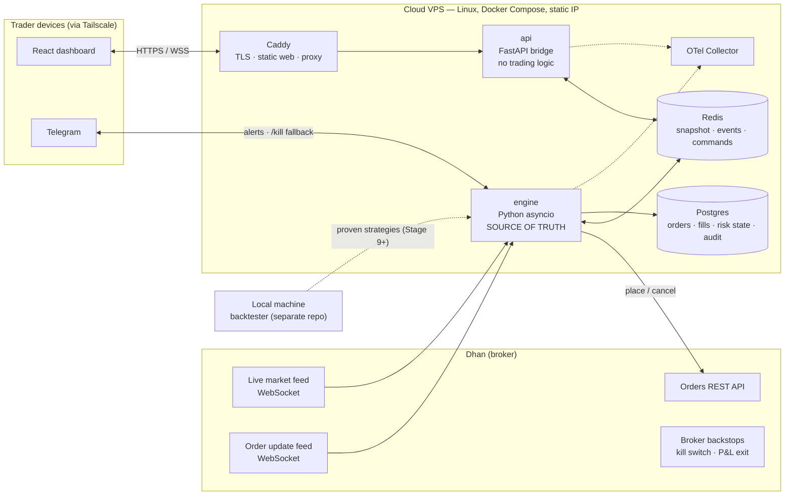
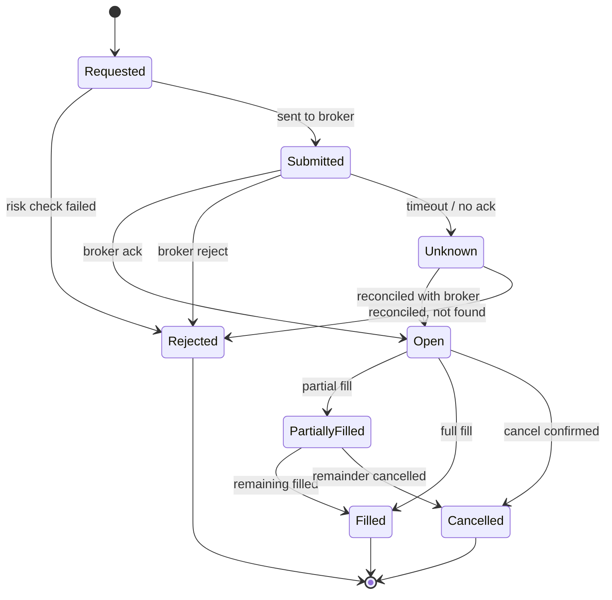
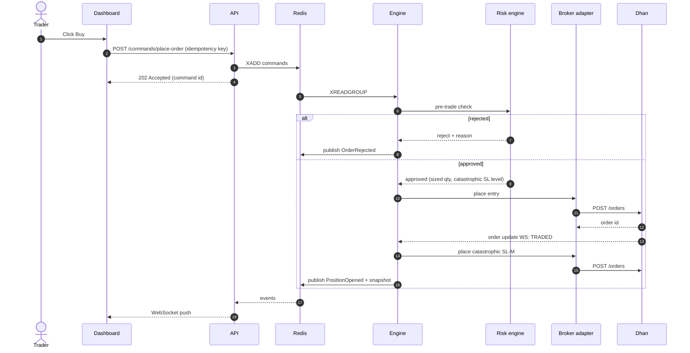
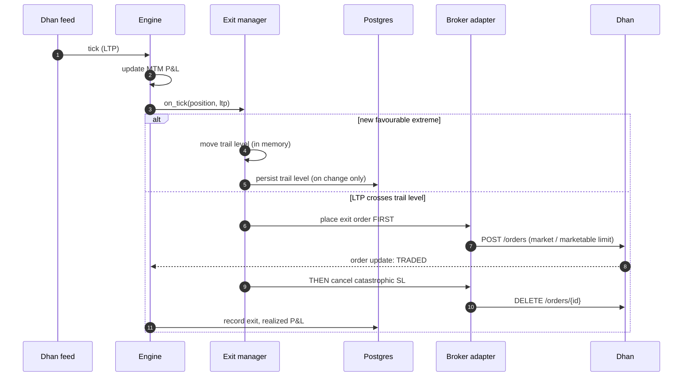
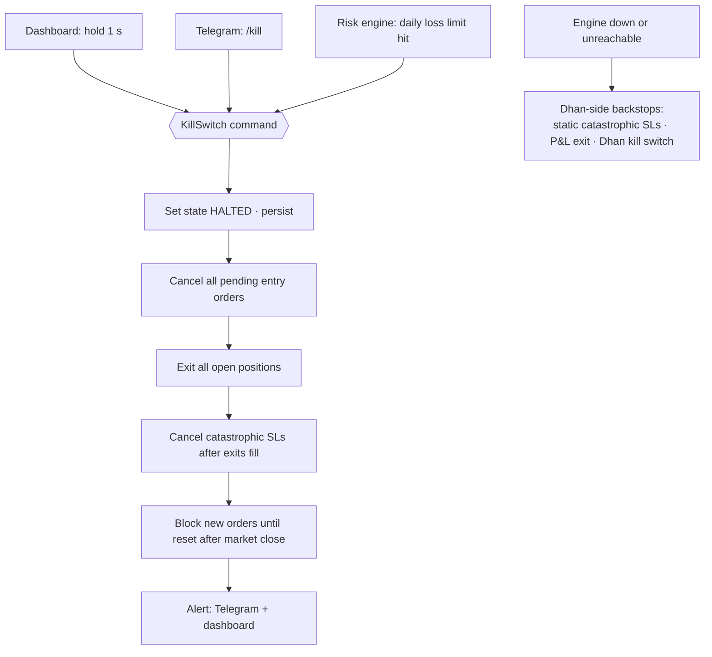
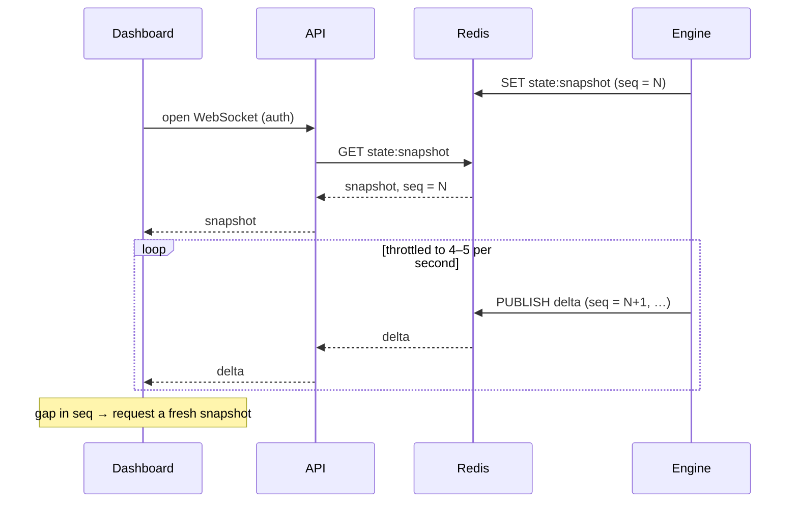
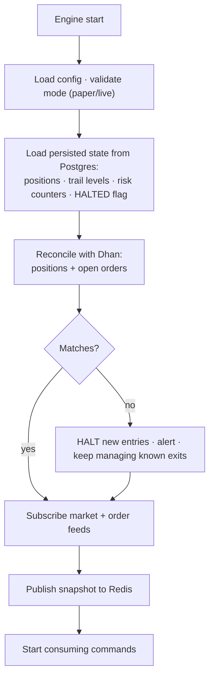
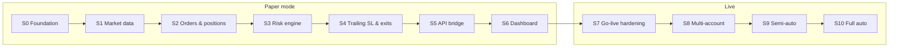

# PRD — SentinelX

| | |
|---|---|
| **Owner** | Balaji |
| **Status** | Draft v2 |
| **Last updated** | 2026-10-25 |
| **Broker** | Dhan (DhanHQ API v2) |
| **Markets** | NSE F&O intraday (primary), NSE equity |
| **Related** | [`CLAUDE.md`](CLAUDE.md) · [`docs/DECISIONS.md`](docs/DECISIONS.md) · [`README.md`](README.md) |

> Placeholder decisions pending confirmation are marked **⚠ ASSUMPTION** (see §12).

---

## 1. Summary

A self-hosted, always-on trading platform running on a Linux VPS. A headless Python engine owns all trading state (positions, P&L, stop-losses, risk limits) and is the **only** component that talks to Dhan. A React dashboard lets a human trade with one click, watch live positions, and hit an emergency kill switch. The platform starts with manual entries and automated exits, and grows stage by stage toward fully automated strategies.

## 2. Goals and non-goals

### Goals
1. **Safe execution** — every order, manual or automated, passes the same risk engine.
2. **Automated position management** — trailing stop-loss, exits, and daily loss limits run in the engine, with or without a browser open.
3. **Fast, clear dashboard** — live position values within about 1 second, one-click trade, hold-to-confirm kill switch, usable on a phone.
4. **Observability** — every order traceable end to end (OpenTelemetry), with measured latency.
5. **Incremental path to full automation** — manual → semi-auto → full auto by switching modes, not rewriting.

### Non-goals (this repo)
- Strategy backtesting (stays on the local machine, separate project — D-005).
- Charting / trading from charts.
- Multi-tenant SaaS for other traders (revisit later — D-004).
- Rust engine (deferred; swap point is the `BrokerAdapter` — D-009).
- F&O Trade Validator (stays a separate service; may plug in as an extra pre-trade check in Stage 9).
- Zerodha integration: Zerodha accounts stay manual, for long-term investing, outside the platform (D-022).

## 3. Operating modes

| Mode | Who decides entries | Who manages exits | Available from |
|---|---|---|---|
| **Manual** | Trader clicks Trade | Engine (trailing SL, risk) | Stage 6 |
| **Semi-auto** | Strategy proposes, trader approves | Engine | Stage 9 |
| **Full auto** | Strategy | Engine | Stage 10 |

Independently, every mode runs in **Paper** (simulated fills against live prices, no broker orders) or **Live**. Paper is the default; Live requires explicit configuration (§9.3).

## 4. Architecture

### 4.1 Components

| Component | Responsibility | If it fails |
|---|---|---|
| **engine** | Market data, orders, positions, MTM P&L, risk engine, trailing SL, Telegram alerts/kill fallback. Only code that calls Dhan. | Exchange-side catastrophic SLs + Dhan backstops protect positions; engine auto-restarts and reconciles (§6.5). |
| **Redis** | Latest state snapshot, event deltas (pub/sub), command queue (Redis Stream). | Engine keeps trading and persisting; dashboard goes stale. |
| **Postgres** | Durable record: orders, fills, positions, trail levels, daily risk counters, audit log. | Engine halts new entries (fail closed), keeps managing exits in memory, alerts. |
| **api** | Translates Redis ↔ browser (REST commands, WebSocket stream), auth. | No effect on trading. |
| **web** | Display + human commands. | No effect on trading. |
| **Caddy** | HTTPS, serves built web files, proxies `/api` and `/ws`. | Dashboard unreachable; Telegram fallback still works. |

### 4.2 Hard boundaries (enforced in CI by `import-linter`)
- `api` never imports `engine`.
- `contracts` imports nothing internal and holds only messages and shared types.
- `observability` (shared logging, masking, tracing) never imports `engine`, `api` or `cli`; `contracts` never imports it (D-024).
- Only `engine.broker` imports the `dhanhq` SDK or calls Dhan.
- Market data (`MarketDataProvider`) is a separate interface from execution (`BrokerAdapter`), even though both are Dhan today (D-023).

## 5. Order lifecycle

**Rule:** an order in `Unknown` is **never** blindly retried — the engine reconciles against Dhan's order book first. Retrying could double the position.

## 6. Key flows

### 6.1 Manual order placement

In **Paper** mode, the broker adapter is `PaperBroker`: it fills against the live LTP (last traded price) with configurable slippage, deducts trading costs (brokerage, STT, exchange/SEBI fees, stamp duty, GST), and never calls Dhan.

### 6.2 Tick → trailing stop-loss → exit

- The trailing level lives **only in the engine** — no per-tick order modification at Dhan (D-006).
- **How** the level moves is a selectable method (ATR Chandelier, N-candle low, Supertrend, step trail, Parabolic SAR, EMA close, fixed %, …), chosen per trade with a configured default (D-025). Catalogue and decision guide: [`docs/trailing-sl.md`](docs/trailing-sl.md). Every method only ever tightens the stop.
- **Exit before cancel:** placing the exit first keeps the position protected during the ~150–300 ms of two broker calls (D-007).

### 6.3 Kill switch

The Telegram path is handled **inside the engine**, so it works when the API, Redis consumer, or dashboard is down.

### 6.4 Dashboard connect (snapshot + deltas)

### 6.5 Engine startup and recovery

## 7. Risk engine requirements

All limits are configuration, stored in Postgres, editable from the dashboard. Values below are **examples, not recommendations**.

| Rule | Definition | Example | On breach |
|---|---|---|---|
| Per-trade max risk | (entry − SL) × qty × lot size | ₹1,000 | Reject order |
| Position sizing | Qty derived from per-trade risk, rounded **down** to whole lots | — | Auto-size; reject if < 1 lot |
| Daily max loss | Realized P&L + MTM (unrealized P&L at current prices) | ₹3,000 | Kill switch (§6.3) |
| Max trades per day | Count of entries | 10 | Reject new entries |
| Consecutive-loss cooldown | N losses in a row → pause | 3 → 30 min | Reject entries until cooldown ends |
| Max open positions | Concurrent positions, total and per underlying | 5 / 2 | Reject order |
| Entry cutoff | No new entries after time | 15:00 IST | Reject entries |
| Own square-off | Exit all intraday positions before broker auto square-off | 15:10 IST | Auto-exit |
| Price sanity | Limit price within ±X% of LTP | 2% | Reject order |
| Quantity sanity | Per-order qty ≤ exchange freeze quantity | per underlying | Reject or slice |
| Broker rate limit | Client-side token bucket (§10) | Dhan limits | Queue by priority (exits first) |
| Limit edits in market hours | **Tighten-only** during 09:15–15:30 IST | — | Loosening rejected until close |

**Fail closed:** if risk state can't be loaded or checked, the order is rejected.

## 8. Dashboard requirements

- **Positions table:** instrument, qty, avg price, LTP, MTM P&L, trail level, distance to trail — updated live (≤ 1 s staleness).
- **Trade panel:** instrument search, Buy/Sell, SL distance, trailing method (pre-filled with the configured default, changeable per trade, with its parameters), computed qty and ₹ risk shown before submit; button disabled while pending; unique idempotency key per click.
- **Order feedback:** Pending → Placed → Filled / Rejected (with Dhan's reason).
- **Kill switch:** hold-to-confirm (~1 s), always visible.
- **Risk status:** today's P&L vs daily limit, trades used, cooldown timer, HALTED banner.
- **Header:** PAPER / LIVE badge, connection status ("LIVE · updated 0.2 s ago").
- **Mobile-first** layout for trade panel and kill switch.
- No charts.

## 9. Non-functional requirements

### 9.1 Performance (measured via OpenTelemetry from Stage 0)

| Path | Target |
|---|---|
| Tick received → exit decision (in engine) | p99 < 5 ms |
| Exit decision → Dhan order submitted and acked | p95 < 200 ms (network-bound; measure, don't assume) |
| Click → order acked (manual) | p95 < 300 ms |
| Engine state → dashboard | < 1 s |
| Engine restart → trading resumed | < 30 s |

### 9.2 Reliability
- Engine runs headless; has no runtime dependency on `api` or `web`.
- Docker `restart: unless-stopped` on all services.
- State persisted on every material change; restart reconciles with Dhan (§6.5).
- Dhan access-token expiry detected and alerted ahead of time.

### 9.3 Security
- Dashboard reachable **only over Tailscale**, plus login.
- Secrets (Dhan client ID, access token, Telegram token) in `.env` / Docker secrets; never committed, never logged.
- Live mode requires `TRADING_MODE=live` **and** a confirmation flag; default is paper.
- VPS egress IP = the static IP whitelisted on Dhan for order APIs.
- Full audit log of every command (who, when, source: UI / Telegram / strategy / risk).

### 9.4 Data correctness
- Money and prices as `Decimal`, never `float`.
- Prices rounded to instrument tick size (e.g. ₹0.05 for NSE options).
- Timestamps stored timezone-aware in UTC, displayed in IST.

## 10. Broker constraints (Dhan — verify against current docs before Stage 7)

| Limit | Value |
|---|---|
| Order APIs | 10/sec · 250/min · 1,000/hour · 7,000/day |
| Modifications per order | 25 |
| Market quote APIs | 1/sec |
| Order-API access | Static IP whitelisting |

Implication: trailing SL must be algo-side; 10 simultaneous exits already saturate one second of order capacity, so exits get priority in the rate limiter.

## 11. Delivery stages

Each stage is one or more OpenSpec changes (`openspec/changes/<id>/`). A stage is done when its acceptance criteria pass in CI and the change is archived.

### Stage overview

S0–S7 are **Phase 1**: one account (the owner's), ending in live trading. S8–S10 add the second account and automation. The detailed scope and acceptance for each stage follow the table; this table is the summary and must be kept in step with them.

| Stage | OpenSpec change | What gets built | Done when |
|---|---|---|---|
| **S0 Foundation** | `add-foundation` | Repo layout, uv project, Docker Compose (engine, api, redis, postgres, caddy, otel + one-shot migrate), config with paper/live gate, structured logging with masking, OpenTelemetry, CI, `.env.example` | All services healthy; one trace spans engine and api; CI green |
| **S1 Market data** | `add-market-data` | Dhan auth/token handling, instrument master (security ID, lot size, tick size, freeze qty), live feed with auto-reconnect, `SimulatedFeed`, internal tick bus, candle builder with historical warm-up | Ticks reach consumers; a forced disconnect recovers on its own; the simulated feed uses the same code path |
| **S2 Orders & positions** | `add-order-position-core` | Contracts and DB tables carrying `account_id`, `BrokerAdapter` protocol, `PaperBroker` with slippage and trading costs, required `RiskGate` pre-trade seam (paper-only stub gate), read-only Dhan adapter (order book, positions, order-update feed), order state machine, positions and MTM P&L, migrations, restart recovery and reconciliation, test CLI | Paper orders fill against live prices; kill -9 then restart restores identical state; `Unknown` orders are reconciled, never retried; no order path skips the `RiskGate`; reconciliation passes against recorded real Dhan responses |
| **S3 Risk engine** | `add-risk-engine` | All §7 risk rules behind the S2 `RiskGate` seam (replacing the stub), catastrophic SL on entry, kill switch, rate limiter with exit priority, tighten-only edits in market hours | One unit test per rule; the kill switch flattens everything and blocks entries; fail-closed is verified with Postgres down |
| **S4 Trailing SL & exits** | `add-trailing-exits` | Pluggable trailing-SL methods chosen per trade with a default (D-025, [`docs/trailing-sl.md`](docs/trailing-sl.md)), exit manager with exit-before-cancel, persisted trail and method state | Scripted price paths give the expected exits for every method, long and short (property-based tests); trail state survives restart |
| **S5 API bridge** | `add-api-bridge` | FastAPI REST commands, WebSocket stream, auth (including the S0 diagnostic endpoint), OpenAPI → TypeScript types | Commands round-trip with idempotency; killing the api container has no effect on the engine |
| **S6 Dashboard** | `add-dashboard` | React + TS + Vite + Tailwind + shadcn/ui + Zustand UI (§8) | Full manual paper trading from a phone over Tailscale |
| **S7 Go-live hardening** | `add-live-trading` | `DhanBroker` order placement (extends the S2 read-only adapter), Telegram alerts and `/kill`, Dhan P&L-exit backstop, latency dashboards, `docs/runbook.md` | One week of small-size live forward testing with measured latencies and zero unreconciled orders |
| **S8 Multi-account** | `add-multi-account` | Spouse's Dhan account on the shared static IP, per-account credentials, risk limits, kill switch, rate limits, dashboard account switcher | One account's breach or kill switch never affects the other |
| **S9 Semi-auto** | `add-semi-auto-signals` | Strategy signal interface, authenticated TradingView webhook, one-click approval queue, optional F&O Validator check | Signal → approval → order, all through the risk engine; a replayed webhook is rejected (HMAC + idempotency) |
| **S10 Full auto** | `add-full-auto` | Per-strategy auto mode, strategy-level risk budgets, daily summary report | A strategy runs a full session unattended in paper, then live at small size |

Per-stage workflow: `/opsx:propose <change-id>` → `openspec validate <change-id> --strict` → owner approval → implement tasks in order → CI green → `/opsx:archive <change-id>`. Progress per stage is tracked in the README's Status table.

### S0 — Foundation · `add-foundation`
- **Scope:** repo layout, `pyproject.toml` (uv), Docker Compose (engine, api, redis, postgres, caddy, otel-collector), config loading, structured logging, OpenTelemetry, CI (ruff, mypy --strict, pytest, import-linter, openspec validate), `.env.example`.
- **Accept:** `docker compose up` → all services healthy; one trace visible across engine and api; CI green on an empty skeleton.

### S1 — Market data · `add-market-data`
- **Scope:** Dhan auth/token handling, instrument master download + lookup (security ID, lot size, tick size, freeze qty), live feed client with auto-reconnect, `SimulatedFeed` for after-hours dev, internal tick bus. Candle builder (ticks → 1m/5m/15m candles, completed candles only) and recent historical candles to warm up indicators, needed by the candle-based trailing methods (D-025).
- **Accept:** ticks for configured instruments reach engine consumers; forced disconnect recovers automatically; simulated feed drives the same code path.

### S2 — Orders & positions · `add-order-position-core`
- **Scope:** `contracts` models and DB tables carrying `account_id` (single account in Phase 1 — D-020), `BrokerAdapter` protocol, `PaperBroker` (fills with configurable slippage **and** trading costs — brokerage, STT, exchange/SEBI fees, stamp duty, GST — so paper P&L is not overstated; see [`docs/field-notes-option-buying.md`](docs/field-notes-option-buying.md)), order state machine (§5), order-update handling, positions + MTM P&L, Postgres persistence (migrations), restart recovery and reconciliation (§6.5), test CLI. Order contract carries the product type (§12 Q11).
  - **`RiskGate` seam:** the order service takes a required pre-trade `RiskGate` (a `Protocol`) as a constructor dependency, so every order source (CLI now, API/strategies/exits later) passes through it. S2 ships a stub gate that rejects every order unless the trading mode is paper; S3 replaces it with the real rules at the same seam, without touching call sites.
  - **Read-only Dhan adapter** (in `engine.broker`): fetches the order book and positions and subscribes to the order-update feed, but exposes no place/modify/cancel. It lets reconciliation and order-update parsing be built against real Dhan responses, recorded as test fixtures, long before S7 turns on order placement.
- **Accept:** paper orders fill against live prices; kill -9 the engine → restart restores identical state; `Unknown` orders reconciled, never retried; a test shows no order path reaches the broker without the `RiskGate`; reconciliation and order-update parsing pass against recorded real Dhan responses; the read-only adapter has no order-placing methods.

### S3 — Risk engine · `add-risk-engine`
- **Scope:** all §7 rules implemented as the real `RiskGate` (replacing S2's paper-only stub), product-type-aware where §12 Q11 requires it, catastrophic SL placement on entry (and for carried positions, per §12 Q12), daily-loss treatment of carried positions (§12 Q13), kill switch (§6.3), client-side rate limiter with exit priority, tighten-only edits during market hours.
- **Accept:** a unit test per rule; kill switch flattens all and blocks entries; fail-closed verified with Postgres down.

### S4 — Trailing SL & exits · `add-trailing-exits`
- **Scope:** pluggable trailing-SL methods per [`docs/trailing-sl.md`](docs/trailing-sl.md) (D-025): ATR Chandelier, N-candle lowest low, Supertrend, step trail, Parabolic SAR, Nth-candle-back low, EMA close trail, fixed % / points; long and short; a named preset "fixed % SL + step at +X%" (e.g. 30% SL, shift at +20% — external hypothesis, to be backtested); the price series each method trails on (option premium vs underlying — §12 Q9) decided in this change; configured default plus per-trade choice (CLI until S6); exit manager with exit-before-cancel; persisted trail state including each method's internal state.
- **Accept:** scripted price paths produce the expected exits for every method, long and short (property-based tests: the stop never loosens and never starts looser than the initial SL); trail level and method state survive restart.

### S5 — API bridge · `add-api-bridge`
- **Scope:** FastAPI REST commands + WebSocket stream (§6.4), auth, OpenAPI → TypeScript type generation. Put the Stage 0 diagnostic `POST /diagnostics/ping` behind auth.
- **Accept:** commands round-trip with idempotency; killing the api container has zero effect on the engine.

### S6 — Dashboard · `add-dashboard` (⚠ ASSUMPTION: stays at S6; CLI used before this)
- **Scope:** §8 in React + TS + Vite + Tailwind + shadcn/ui + Zustand. Trade stats show expectancy (average P&L per trade) and payoff ratio (avg win ÷ avg loss) alongside win rate — engine-computed, UI displays only.
- **Accept:** full manual paper trading from a phone over Tailscale.

### S7 — Go-live hardening · `add-live-trading`
- **Scope:** `DhanBroker` order placement enabled (extending the S2 read-only adapter), Telegram alerts + `/kill`, Dhan P&L-exit backstop configured, latency dashboards, runbook (`docs/runbook.md`).
- **Accept:** one week of small-size live forward testing with measured latencies and zero unreconciled orders.

### S8 — Multi-account · `add-multi-account`
- **Scope:** add the owner's spouse's Dhan account alongside the owner's, sharing the static IP through Dhan's family static IP mapping (approved via apihelp@dhan.co before this stage); per-account credentials, risk limits, kill switch, rate limits, and a dashboard account switcher.
- **Accept:** one account's breach or kill switch never affects another.

### S9 — Semi-auto · `add-semi-auto-signals`
- **Scope:** strategy signal interface (Python strategies from the local backtester), authenticated TradingView webhook, one-click approval queue in the dashboard; optional F&O Validator check.
- **Accept:** signal → approval → order, all through the risk engine; webhook replay rejected (HMAC + idempotency).

### S10 — Full auto · `add-full-auto`
- **Scope:** per-strategy auto mode, strategy-level risk budgets, daily summary report (including expectancy and payoff ratio per strategy); rolling expectancy per strategy with an alert — and optional auto-pause — when it falls below a configured floor (edge decay).
- **Accept:** a strategy runs a full session unattended in paper, then live at small size.

## 12. Open questions and assumptions

| # | Item | Current assumption |
|---|---|---|
| Q1 | Project name | **Resolved:** SentinelX |
| Q2 | Family accounts needed at first go-live? | **Resolved:** No. Phase 1 = owner's Dhan account only; `account_id` in the data model from S2; spouse's Dhan account in S8; Zerodha stays manual (D-020, D-022) |
| Q3 | Bare-bones UI earlier than S6? | No — CLI + tests until S6 |
| Q4 | Dhan Data API subscription needed for the live feed? | **Resolved (2026-10-27):** Yes. Confirmed via `python -m cli dhan profile`: `dataPlan` Active, `dataValidity` 2026-11-27. Renew before it lapses; the engine refuses to start the feed when the plan is inactive |
| Q5 | Dhan access-token lifetime and renewal flow | To confirm before S1 |
| Q6 | VPS provider (Mumbai region) and static IP binding | To confirm before S7 |
| Q7 | Dhan family static IP mapping for spouse's account | Owner to request via apihelp@dhan.co; needed before S8 |
| Q8 | Kill path that does not depend on the dashboard before S7 | Open. Telegram `/kill` (D-021) arrives only in S7, so during S3–S6 the kill switch is reachable only from the CLI and (from S6) the dashboard; Dhan's own kill switch remains the backstop. Decide before S3 whether to bring Telegram `/kill` forward |
| Q9 | Trailing SL price source for options: option premium or underlying? | Open; decide in S4 (may refine D-025 via a new decision entry). Both are used in practice — the external notes use 30% of premium for option *buying*; the owner's view is that premium-based stops are mainly an option-*selling* practice. The candle-based methods need candles on whichever series is chosen ([`docs/field-notes-option-buying.md`](docs/field-notes-option-buying.md)) |
| Q10 | Option selling and multi-leg strategies (straddles, strangles, spreads) in scope? | Open. Not designed for today: the engine models single-leg orders, the risk engine has no margin check, and there is no basket/leg-ordering or combined-premium SL. Decide before S9; would need its own OpenSpec change and decision entries |
| Q11 | Equity product types in scope: intraday (MIS) only, or delivery (CNC) too? | **Resolved (2026-10-28):** both, chosen by strategy. Product type is a field on every order and position from S2, with each strategy (or manual trade) choosing its own product type. Consequences: a SELL is a short only for intraday products (cash-equity shorts are intraday-only; a CNC SELL is valid only against held quantity); the 15:10 own square-off applies to intraday products only; carried positions enter the next day's reconciliation (S2) and risk (S3). Equity lot size is 1 and freeze quantity does not apply, so the §7 sizing and quantity-sanity rules need per-segment handling. Follow-ups: Q12, Q13 |
| Q12 | Exchange-side catastrophic SL for positions held overnight | Open; decide in S3. A day SL-M order expires at the close, so a carried CNC position has no exchange-side protection overnight and at the next open unless the SL is re-placed each morning (on engine start, after reconciliation) or a broker-side persistent order (e.g. Dhan Forever Order) is used. Trailing state must also persist across days (S4) |
| Q13 | Daily max loss with carried positions | Open; decide in S3. Whether a carried position's MTM counts from the previous close (today's change only) or from entry; and whether carried CNC positions count toward max open positions and the kill switch flatten |

## 13. References
- Decision log with rationale and rejected alternatives: [`docs/DECISIONS.md`](docs/DECISIONS.md)
- External field notes on intraday NIFTY option buying (unverified hypotheses): [`docs/field-notes-option-buying.md`](docs/field-notes-option-buying.md)
- Dhan API docs: https://dhanhq.co/docs/v2/
- OpenSpec: https://openspec.dev
